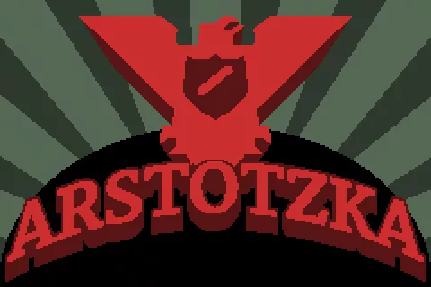

# Arstotzka-Generator



A simple video generator of a custom ending of the famous Papers Please game. Works on a Windows environment.
It uses the images from the **ending n°10** of the game.

## [Example](example.mp4)

## How to use?

### I'm new to this, what the fuck is Python

This guide helps **any Windows user**, even with **zero coding experience**, to run the Arstotzka Generator and create the **jail.mp4** video.

---

#### 🔽 Step 1: Download the Project

1. Click this link: [Arstotzka-Generator GitHub](https://github.com/Valenwe/Arstotzka-Generator)
2. Click the green **"Code"** button.
3. Choose **"Download ZIP"**, then **extract** the ZIP file to a folder on your computer (e.g., your Desktop).

---

#### 🐍 Step 2: Install Python (One-Time Only)

1. Go to [https://www.python.org/downloads/](https://www.python.org/downloads/)
2. Search for any Python release in **"Looking for a specific release?"** matching **Python 3.11.x**
3. Click **"Download"**
4. During installation:

   * ✅ Check the box **"Add Python to PATH"**
   * ✅ Click **"Install Now"**

---

#### 🧱 Step 3: Install the Required Tools

1. Open the folder where you extracted the project.
2. Hold **Shift** and **right-click** in an empty space in the folder.
3. Click **"Open PowerShell window here"** or **"Open in Terminal"**
4. Copy and paste this command into the window and press **Enter**:

   ```
   pip install -r requirements.txt
   ```

---

#### 🎬 Step 4: Download FFmpeg

1. Visit: [FFmpeg Windows Builds](https://github.com/BtbN/FFmpeg-Builds/releases)
2. Download the latest **ffmpeg-nnnnnnn-full\_build.zip** file under **Assets**.
3. Extract the ZIP.
4. Find the `ffmpeg.exe` file (inside `bin/`).
5. Copy **ffmpeg.exe** into the **same folder** as `main.py` (your project folder).

   ✅ *Skip any setup with PATH. Just place the `ffmpeg.exe` in the project folder.*

---

#### 📝 Step 5: Write Your Report

1. Open `report.txt` (just double-click it)
2. Type **your own short story, description, or message** — one sentence or paragraph **per line**

   * You can have **up to 4 lines**
   * Each line becomes a **frame** in the final video

   ✅ Example:

   ```
   Subject has been seen crossing the border.
   Papers were forged using outdated template.
   Claimed to be on diplomatic mission.
   Detainment is authorized immediately.
   ```

---

#### ▶️ Step 6: Run the Program

1. In the same folder, **double-click** the file called `run.bat` (create it as described below).

   * Open Notepad.

   * Paste this:

     ```bat
     @echo off
     python main.py
     pause
     ```

   * Click **File > Save As**

     * Name it: `run.bat`
     * Save it in the **project folder**

---

#### 🎉 Step 7: Enjoy the Result!

After running, you'll get a video file named:

```
jail.mp4
```

🎞️ This file will appear in the same folder as the script. Open it with any video player and enjoy your creation!

---

### TLDR

*(for people that already handled Python projects before)*

1. Clone the repository (git clone https://github.com/Valenwe/Arstotzka-Generator) and install Python 3.11
2. Install the requirements necessary with `pip install -r requirements.txt`.
3. [Download](https://github.com/BtbN/FFmpeg-Builds/releases) the **ffmpeg.exe** binary either in your PATH environment, or simply in the root directory of the project.
4. Change the text file `report.txt` content, with **each line** corresponding to an image. There is a total of **4 maximum images**, so **4 lines** in the text file.
5. Run the Python script from the root directory through `python main.py`.
6. Enjoy! (the video will be named **jail.mp4**)

N.B: There will always be a last image with the **Arstotzka** propaganda and the famous three words **Glory to Arstotzka**.

## Can I custom the images?

- Of course you can! To do that, you have to keep the same syntax (starting from *0.png* to *X.png*) in `/imgs`, and the same resolution aswell, such as **480 x 320** (if the resolution is different, the program will stretch the image).
- It is also possible to change the background music, which correspond to the file `sounds/Death.wav`.